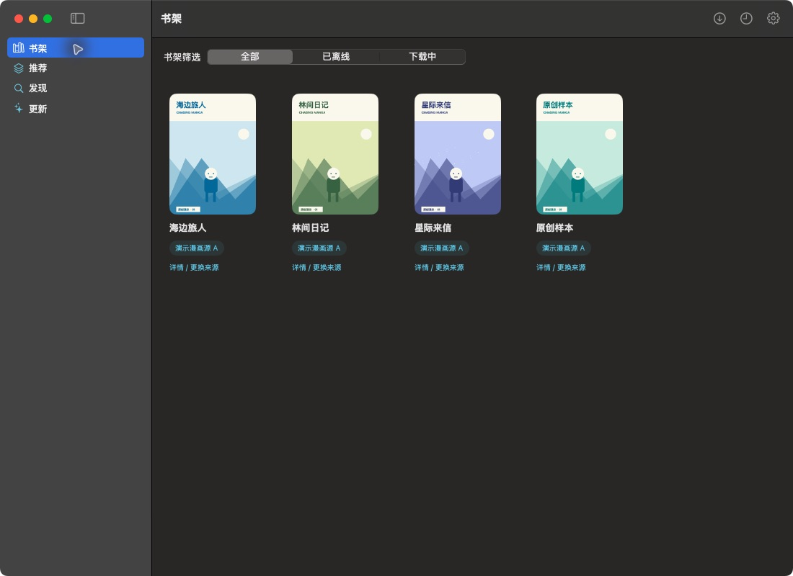
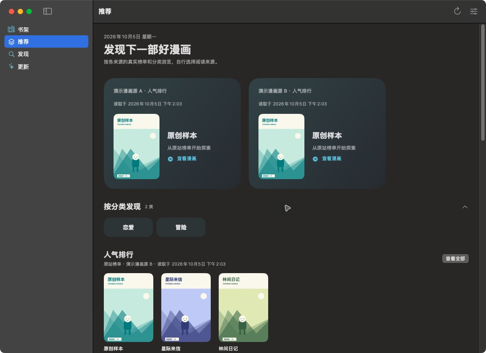
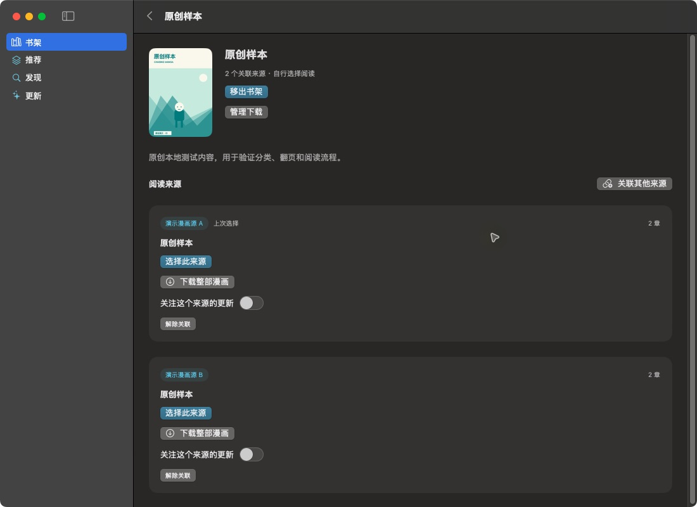
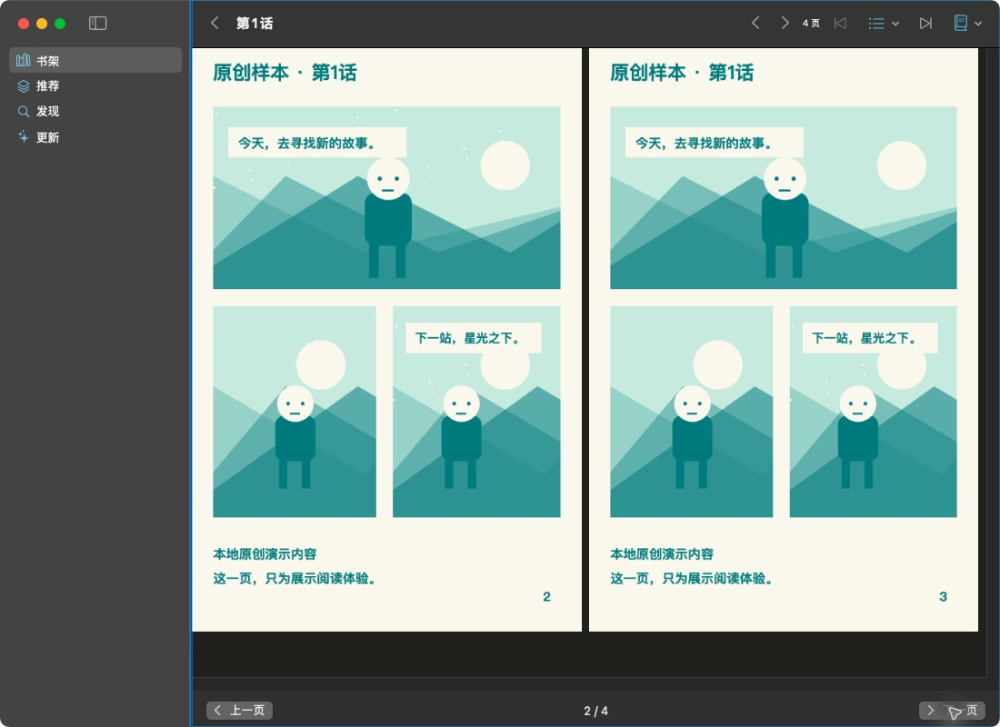
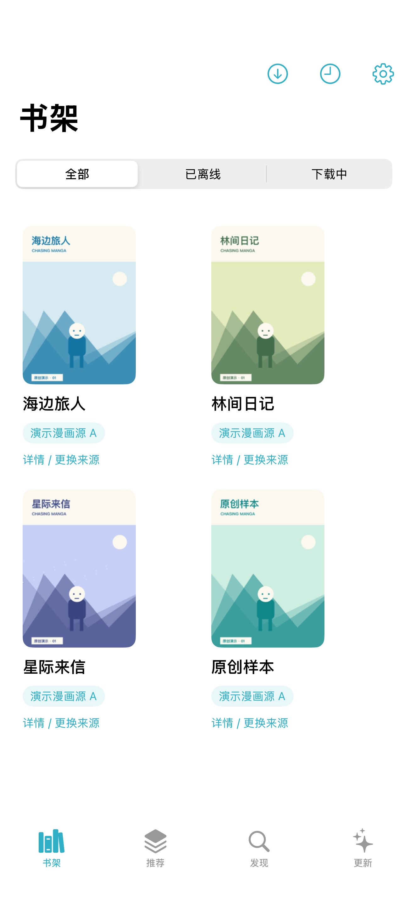
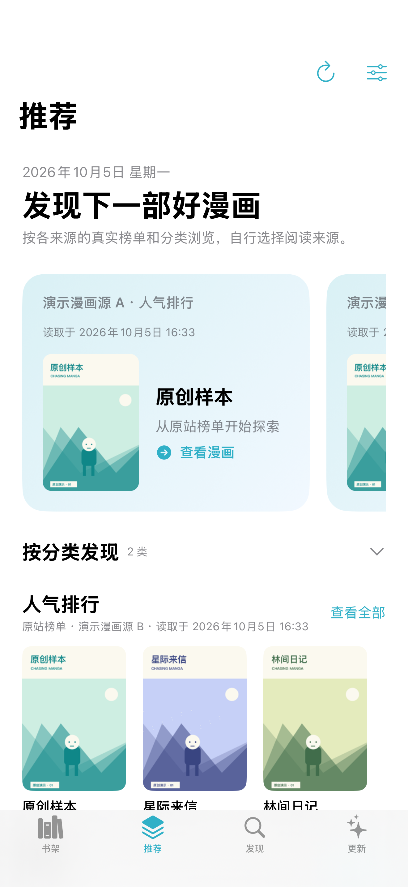
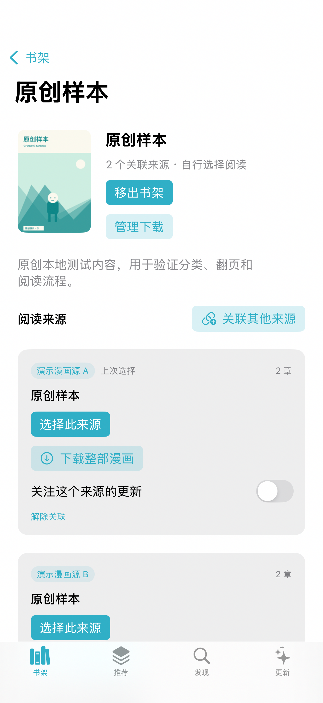
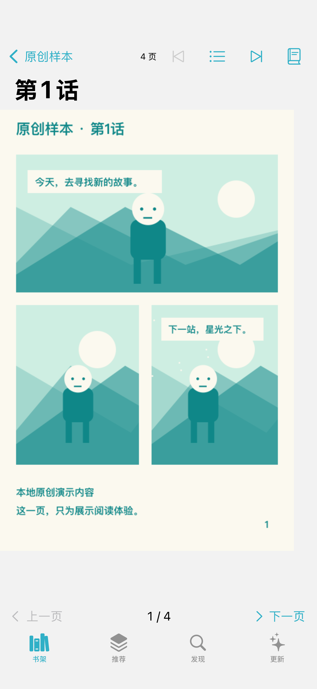

# 追漫 · Chasing Manga

Swift / SwiftUI 原生漫画阅读器，支持 iOS 17+ 与 macOS 14+，每端保存自己的书架、历史、下载与设置。v0.3.10 新增77漫画、好看漫画，支持搜索、分类浏览、目录、阅读与离线下载；古古漫画作为暂不可用来源列出。保留发现中的全部来源、单源与自定义多源搜索。保留 v0.3.8 新增的多看漫画、风车漫画适配器；风车搜索遇到网站验证时仍需在来源页面手动完成验证。保留跨源搜索、关联来源、自定义解析器绑定、整部下载、批量清理与纵向双向跨话阅读。兼容 macOS 15.7.7 / iOS 18.5，构建固定使用 Xcode 16.4，不要求升级设备系统。新来源说明见 [v0.3.10 记录](docs/new-sources-0.3.10.md)，搜索范围说明见 [v0.3.9 记录](docs/search-scope-0.3.9.md)，漫画源接入见 [v0.3.8 记录](docs/duokan-fengche-0.3.8.md)，瓜子来源访问限制见 [v0.3.7 记录](docs/guazi-access-0.3.7.md)，下载提速见 [v0.3.6 记录](docs/ios-download-throughput-0.3.6.md)。

## 界面展示

以下为 v0.3.2 的真实原生界面，使用独立的本地演示数据、虚构漫画源与原创插画，不包含个人书架、账号或设备标识。点击图片可查看大图；演示推荐与排行不代表线上来源的实际热门数据。详见 [截图说明](docs/showcase/README.md)。

### macOS

在 macOS 15.7.7 上采集，展示深色界面与桌面双页阅读。

| 书架与离线筛选 | 推荐与分类浏览 |
| :---: | :---: |
| [](docs/showcase/macos-library.jpg) | [](docs/showcase/macos-recommendations.jpg) |
| **关联来源与整部下载** | **双页阅读** |
| [](docs/showcase/macos-work.jpg) | [](docs/showcase/macos-reader.jpg) |

### iOS

在 iOS 18.5 真机上采集，展示浅色界面与逐页阅读。

| 书架 | 推荐 |
| :---: | :---: |
| <a href="docs/showcase/ios-library.png"></a> | <a href="docs/showcase/ios-recommendations.png"></a> |
| **作品与来源** | **逐页阅读** |
| <a href="docs/showcase/ios-work.png"></a> | <a href="docs/showcase/ios-reader.png"></a> |

## 功能

- 内置漫画站、瓜子漫画、DM5、MangaDex、包子漫画 org、MangaBZ、ComicFury、Dinosaur Comics、xkcd、多看漫画、风车漫画、77漫画、好看漫画的独立适配器；访问限制与解析失败分别提示。MangaDex 显示章节语言及汉化组，xkcd 与 Dinosaur Comics 为英文原创系列，ComicFury 为英文原创漫画平台。
- 自定义网址与作品样本：依次尝试内置解析器，验证目录和真实图片后绑定方法与版本；有限样本或歧义需要明确处理；样本须位于来源配置的网址与子路径范围内。
- 多源搜索、手动关联/解除关联、用户选择阅读来源与跨源续读候选；仅阅读能力的来源可从已验证作品或详情网址进入。
- 书架、历史、更新、离线下载；通知默认关闭。
- 作品详情或章节页一键下载所选来源全部已发布可读章节，刷新完整目录，跳过已有任务和受限内容；单章解析失败继续处理，显示失败章节名称并支持再次点击补齐。
- 纵向滚动、逐页、左右阅读方向、macOS 双页、缩放与页内进度。
- 优先当前页、有限预加载、独立缓存/离线目录，过期资源重新取地址。

## macOS 直接使用

解压 `ChasingManga-0.3.10-macOS-universal.zip`，将 `ChasingManga.app` 拖入 Applications 后打开。兼容 Apple Silicon 与 Intel，最低 macOS 14；本机实际运行验证为 Apple Silicon。当前使用本地临时签名，未做 Developer ID 公证。

自行构建 macOS 包可用 Swift 工具链与 macOS SDK，无需 iOS SDK：

```sh
MANGA_ARCH=universal scripts/package-macos.sh
```

结果在 `release/`。完整交付与真实使用记录见 [可用性验收](docs/usability-completion.md)。

## 编译运行

直接打开 `ChasingManga.xcodeproj`，选择 `MangaMac` 或 `MangaIOS` scheme。需要完整 Xcode 16.3+（Swift 6.1+）；iOS 真机在 Signing & Capabilities 中选择自己的 Team。详见 [安装说明](docs/build-and-install.md)。无需服务器、登录、同步服务或 XcodeGen。

```sh
swift run MangaChecks
swift build --target MangaUI
```

只有 Command Line Tools 时，可执行共享检查、UI 构建和上述 macOS 包装；无法执行 iOS 构建或本机缺少运行时的 Swift Testing/XCTest。重新生成工程需 XcodeGen **2.46.0**：`scripts/generate-project.sh`。

## 来源状态和验证

见 [真实来源验证](docs/source-validation.md) 和 [验收记录](docs/verification.md)。每个源、每个能力分别验证。首次启动登记候选源并自动检查浏览/搜索；可直接打开浏览/搜索作品，或添加作品样本检测并绑定正文解析方式。不承诺任何网站所有漫画永久免费或持续可用。漫画站搜索当前遇到安全验证；部分 DM5 作品存在地区/付费限制。

网站正文地址来自正常公开页面或其正常请求。不会执行用户插件、生成任意解析脚本或绕过登录/付费限制。HTTP 自定义源也可使用，网址与内容传输的安全性取决于该来源；优先使用 HTTPS。

长图采用 ImageIO 有上限的缩略解码后分块显示，使用 8 Mi 像素预算与分块显示。超过预算的图片可能降低采样清晰度；64 MiB 解码缓存预算不等同于整个 App 的实测峰值。含 Cookie 的下载使用可控制重定向的前台传输，应用挂起后可能暂停。

## 开源

代码采用 [MIT](LICENSE)；网站漫画内容不随本项目授权或分发。依赖许可见 [第三方声明](THIRD_PARTY_NOTICES.md)，解析器贡献规范见 [CONTRIBUTING](CONTRIBUTING.md)。源码发布到本项目远程仓库；设备专用安装包、个人签名材料和应用资料保留在本地。尚未上架 App Store。
